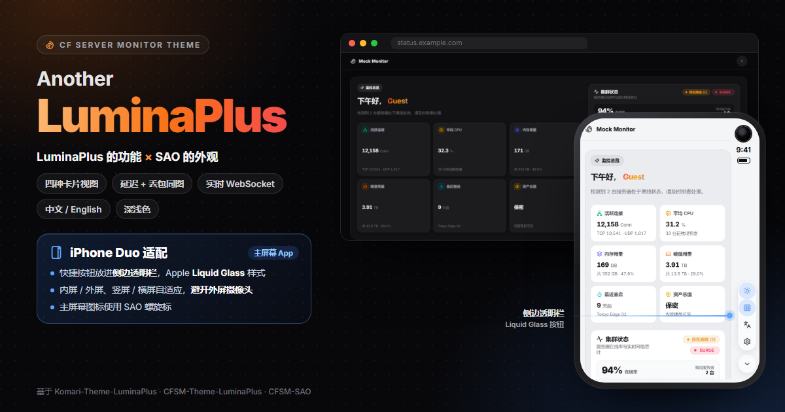

# CFSM-Theme-AnotherLuminaPlus

[CF-Server-Monitor](https://github.com/huilang-me/CF-Server-Monitor) 的第三方主题。

它站在三个项目的肩膀上：功能骨架来自 **[Komari-Theme-LuminaPlus](https://github.com/shanyang242/Komari-Theme-LuminaPlus)**，
由 **[CFSM-Theme-LuminaPlus](https://github.com/volcano-1025/CFSM-Theme-LuminaPlus)** 移植到 CF-Server-Monitor，
本主题在它的基础上二次修改，并把 **[CFSM-SAO](https://github.com/WAOR/CFSM-SAO)** 的界面样式、配色与动效融合进来。
一句话：**LuminaPlus 的功能 + SAO 的外观**。

<p align="center">
  
</p>

## 💖 致谢

这个主题绝大部分的价值来自下面几位作者的开源工作，没有他们就没有 AnotherLuminaPlus。

- **[volcano-1025](https://github.com/volcano-1025) · [CFSM-Theme-LuminaPlus](https://github.com/volcano-1025/CFSM-Theme-LuminaPlus)**
  本主题直接 fork 自这里。是 volcano 把 LuminaPlus 完整移植到了 CF-Server-Monitor：整套数据层改走后端公开 API、
  WebSocket 实时推送与轮询兜底、首页延迟 / 丢包柱子的取数与校正、多线路与线路改名、主题设置自动同步到后端、
  产物分支与主题商店的发布流程…… 本仓库的大部分代码和这份文档的大部分内容都出自 volcano 之手。
- **[WAOR](https://github.com/WAOR) · [CFSM-SAO](https://github.com/WAOR/CFSM-SAO)**
  本主题的「脸」来自 SAO：首页的问候语与六宫格指标总览、服务器集群状态区、卡片与页脚胶囊的样式、
  配色风格与开屏动效、设置页版式、资产悬浮入口、延迟 / 丢包 / 流量色谱自定义，都是 WAOR 的设计与实现。
- **codex & shark & shanyang · [Komari-Theme-LuminaPlus](https://github.com/shanyang242/Komari-Theme-LuminaPlus)**
  LuminaPlus 的原作者。大 / 小 / 迷你 / 列表四种卡片、首页总览与分组筛选、资产统计、详情页图表这些功能和交互的
  最初设计都来自这里；LuminaPlus 本身又是 [stqfdyr](https://github.com/stqfdyr) 的
  [komari-theme-Lumina](https://github.com/stqfdyr/komari-theme-Lumina) 的增强分支，一并致谢。

也感谢 [huilang-me](https://github.com/huilang-me) 的 [CF-Server-Monitor](https://github.com/huilang-me/CF-Server-Monitor)
提供后端与主题商店。以上项目均为 MIT 许可，版权声明见 [LICENSE](LICENSE)。

## 有什么

- **SAO 风格的首页**：问候语 + 六宫格指标总览（连接数、CPU、内存、硬盘、最近重启、资产总值）、
  服务器集群状态（在线率、矩阵图样可自定义）、实时流量，可选多套配色风格与开屏动效。
- **四种卡片视图**：大卡片 / 小卡片 / 迷你卡片 / 列表，右上角快捷按钮可临时切换。
  流量按当前计费周期显示，到期与续费提醒、价格与资产可按需隐藏。
- **分组与地区筛选**：地区标签可以直接拖动排序，站长拖的顺序同步给所有访客。
- **延迟与丢包**：多线路（最多八条，条数可选）或单线路模式；卡片上点线路名即可换线路；
  柱子悬停 / 点按看每一格的时间段与数值，整轮超时画成红格并计入丢包率。
- **详情页**：负载与 Ping 同页，仿哪吒监控的延迟 + 丢包合并图，可点选线路单独看；
  进页取一次历史后接着实时样本继续画，不用刷新。
- **资产统计**：总价值、续费花费、二手溢价等，资产页与悬浮入口可设为公开或仅站长可见。
- **中文 / English**：首次访问按浏览器语言自动选择，切换即时生效、不重载页面。
- **iPhone 主屏幕 App 适配**：包括 iPhone Duo —— 添加到主屏幕后，快捷按钮自动放进 Duo 侧边的透明状态栏，
  采用 Apple 的 Liquid Glass 样式；内屏 / 外屏、竖屏 / 横屏自适应，外屏的摄像头不会挡住按钮和页头横线。
  iOS 27.2 起要让页面铺到侧栏下面，主屏幕 App 必须用透明状态栏：主题在 Duo 上不论深浅色都用透明状态栏，
  升级后需在主屏幕删掉 App 重新添加一次（iOS 只在添加时读取这项设置）。
- **浅色 / 深色 / 跟随系统**，深色模式的深浅可调。

## 安装

不用自己构建，也不用另外找地方部署 —— 主题跟着你现有的 Workers 后端跑，二选一：

**① 主题商店（推荐）**

后台 `/admin#/admin` → 主题商店 → **AnotherLuminaPlus** → 安装并切换。
（商店里的 **LuminaPlus** 是 volcano 的原版，**CFSM-SAO** 是 WAOR 的原版，都不是本主题。）

**② 自定义主题 URL**

想装指定版本时，把下面这行地址填进后台的自定义主题 URL：

```
https://github.com/Vegas7/CFSM-Theme-AnotherLuminaPlus/tree/dist
```

`dist` 是构建产物分支（源码在 `main`，别填错）。想锁定某一版，就把 `dist` 换成那一版产物提交的
40 位 SHA（`.../tree/<40 位 SHA>`）—— 锁住之后本仓库怎么更新都不会影响你。
各版本的 SHA 在 `dist` 分支的提交记录里，提交标题就是版本号。

两种方式都与后端同源，不需要额外配置。站点标题、图标、背景图、自定义 head / script
由后台「外观设置」下发，主题不覆盖它们。

### 更新是手动的

装上之后不会自动升级，出了新版本要自己回后台更新一次：

- **主题商店装的**：回主题商店重新安装 / 更新一次。
- **填 URL 装的**：地址是 `tree/dist` 的话，Workers 对分支地址有约一小时缓存，过了缓存自然就是新版；
  等不及就把地址临时换成新版本的 40 位 SHA。地址本来就锁在 SHA 上的，必须手动改成新 SHA。

线上跑的是哪一版：看页面源码里的 `<meta name="theme-version" content="AnotherLuminaPlus v...">`，
或把鼠标放到页脚的「AnotherLuminaPlus」上。**登录后台之后**，有新版本时页脚名字后面会出现「新版 vX」标签
（版本从本仓库 `dist` 分支读取，只在登录后检查、本机缓存 12 小时，访客不会发出这个请求）。

### 搭配 Egern 小组件（可选）

volcano 还做了配套的 iOS 主屏小组件 [cfsm-egern-widget](https://github.com/volcano-1025/cfsm-egern-widget)：
在 Egern 配置里加一段 scriptings 和 widgets 记录、填上后端地址，就能在手机主屏上看节点状态。
它和本主题互不依赖，装不装都行。

## 主题设置

登录站长后，右上角快捷按钮里有「主题设置」入口，分为 **首页**（外观、展台、权限与评级）、
**服务器**（视图、指标、排序与延迟）、**资产**（费用统计与二手溢价）三组。

- **没有保存按钮**：改完停手约一秒自动保存。登录站长的改动写到后端（`POST /api/theme_options`），
  所有设备与访客都会用这套；同步失败时页面底部提示原因并可重试，改动先留在本机，下次打开接着发。
  只更新主题配置，不碰站点标题、背景图、CSP 等其它外观设置。
- **访客**看不到设置入口；外观、视图、语言、卡片上换过的线路、地区顺序这类个人偏好只存在自己的浏览器里。
- **未登录时**（例如纯静态或跨域部署、登录态带不过来）设置页的改动只存在本机，没有自动同步：用「复制配置 JSON」
  把整份配置粘到后台「外观设置 → 主题自定义配置」，效果一样。某台设备存过本机设置后，
  点设置页的「改用后端配置」即可重新跟随站点。
- 主题设置里没写默认外观时，跟随后台「外观设置 → 默认外观」。
- 后端对外观设置有约 2 分钟的缓存（每个 Worker 实例各一份），保存后换个浏览器看可能还是旧的，等一两分钟即可。
  要确认后端到底下发了什么，在站点页面的控制台跑
  `fetch('/api/config').then(r=>r.json()).then(c=>console.log(c.theme_options))`。

## 数据从哪来

| 主题功能 | 后端接口 |
| --- | --- |
| 站点配置、登录态、主题预设 | `GET /api/config` |
| 节点列表与实时指标、首页延迟窗口 | `GET /api/servers` |
| 实时推送 | `GET /api/ws?subscribe=all` + 通道内 `subscribe` 消息 |
| 详情页的负载 / 延迟历史 | `GET /api/history/all` |

- **实时**：WebSocket 断开时自动退回 5 秒轮询 `/api/servers`；多后端部署下每个后端只订阅属于自己的节点。
  详情页只订阅正在看的那一台，回到首页再恢复订阅全站。
- **页面切到后台满 30 秒会断开实时连接**，切回来立刻重连并补一次数据 —— 后端只要有前端连着就让探针高频上报，
  忘在后台的标签页会一直占着站长的额度。后台设了「前端实时连接超时」时，到时限会断开并询问访客是否继续。
- **首页延迟柱子不查历史**：`/api/history/all` 会扫整段时间窗口的历史行，首页给每台节点每分钟查一次会让后端
  D1 读行翻几十倍。首页以 `/api/servers` 里后端给的探测窗口（约两小时、20 格，跨度跟着后端走）为准，
  浏览器边看边记的实时样本只用来补窗口的缺口。卡片上的**延迟是最近一次采样**，**丢包率是这段窗口的加权平均**；
  要看精确曲线以详情页为准。
- **节点掉线后柱子逐格转红**，铺满整个窗口后整条全红。
- **未登录访客**查询超过 24 小时的历史会被后端拒绝，所以详情页对访客只给到 24 小时档位；登录后可选到 7 天。

## 与 Komari 版的差异

受 CF-Server-Monitor 后端能力约束（大多沿用 CFSM-Theme-LuminaPlus 的处理）：

- **探测线路由后端固定**：电信 / 联通 / 移动 / BD 加四个自定义槽位，共八条；线路显示名跟着后台的命名走。
  探测目标与方式（ICMP / TCP）在后台配置，公开接口不下发。
- **没有「今日流量」和「峰值速度」**：后端只存瞬时速率，没有当天的累计计数器，估出来的数说不清准不准，干脆不显示。
  剩余流量与配额进度用的是后端的月度累计值，不受影响。
- **背景图、站点标题、图标交给后台外观设置**，主题只保留卡片不透明度。
- **旗帜与 OS 图标不打包**，走后端的 `/flags/<code>.svg` 与 `/os-icons/<file>`；跨域部署时自动拼到 `apiBase` 上。
- **路由用 hash**：首页 `/#/`，详情页 `/#/server/:id`（旧的 `#/instance/:uuid` 会自动跳转），资产页 `/#/assets`。
- **管理入口**跳到后端的 `/admin#admin`，由内置默认主题接管。
- 后端不提供虚拟化类型、温度、公网 IP 地址（只有 IPv4 / IPv6 可达性），相关位置显示为空。

## 自行构建部署（可选）

上面的安装方式已经够用，以下适合想自己托管或改代码的人。

### 自己发布产物给 Workers 用

1. `npm run build`，产物在 `dist/`（只有 `index.html` 和 `assets/`）。
2. 把 `index.html` 与 `assets/` 提交到自己的 GitHub 仓库（本仓库由 CI 自动发布到 `dist` 分支）。
3. 在后台填入该仓库的目录地址，或提交到 [CFSM-Theme-Store](https://github.com/huilang-me/CFSM-Theme-Store)。

### 纯静态托管（GitHub Pages 等）

1. 在项目根目录建 `.env`：

   ```ini
   API_BASE=https://status.example.com
   # 多后端用英文逗号分隔：
   # API_BASE=https://a.example.com,https://b.example.com
   TITLE=我的监控
   BACKGROUND_IMAGE=https://example.com/bg.webp
   ```

2. 构建：

   ```bash
   npm run build:github-page
   ```

   它会在 `dist/index.html` 里写入 `<meta name="apiBase">`，并按需注入标题与背景图。
   设了 `TITLE` 页面标题就固定用它；不设则跟随后台外观设置里的站点标题。

3. 在**每一个** Workers 的环境变量里加上 `CORS_ALLOWED_ORIGINS`（位置与 `API_SECRET` 相同），
   把本地开发地址和线上域名都加进去，否则浏览器会拦截 API 请求与 WebSocket：

   ```
   https://localhost:5173,https://<你的用户名>.github.io
   ```

## 发布与验收

`.github/workflows/build-theme.yml` 会在推送时构建并发布产物，两条分支各走各的：

| 推送到 | 产物分支 | 用途 |
| --- | --- | --- |
| `main` | `dist` | 线上主题地址（主题商店跟踪这个分支） |
| `preview` | `dist-preview` | 上线前验收，不影响 `dist` |

验收流程：改动先推 `preview`，等 Actions 跑完，在后台把主题地址临时填成
`https://github.com/Vegas7/CFSM-Theme-AnotherLuminaPlus/tree/dist-preview` 看效果；确认没问题再合进 `main`。

产物提交的说明就是主题商店里的**版本标题与更新日志**，格式固定为：

```
v<package.json 的 version> <更新日志>

build: <源码 commit>
```

- **版本号**取 `package.json` 的 `version`，发版前先改它，并在 [CHANGELOG.md](CHANGELOG.md) 里加一段。
- **更新日志**取本次源码提交的标题（网页合并 PR 取 PR 标题，本地合并取被合进来的最后一次提交标题）。
  版本号会自动加在前面，标题里**不要再写版本号**。
- 只想单独补一条日志（产物没变化）：在 Actions 里手动运行 workflow，填 `changelog` 并勾上 `force`。

Workers 对分支引用有约一小时的缓存，验收时若看到旧版本，把地址换成 40 位 commit SHA 即可绕过。
产物分支只追加提交、从不强推，锁在旧 SHA 的用户和主题商店里登记的历史版本会一直可用；
每次 Actions 日志最后会打印本次产物的 commit。

## 开发

```bash
npm install
npm run dev         # http://localhost:5173
npm run typecheck   # tsc -b
npm run lint        # eslint
npm test            # vitest
npm run build       # 产物只含 index.html + assets/
```

- 手边没有后端时，用 `http://localhost:5173/?mock=1` 打开内置假数据。
- 想连线上后端调试，在仓库根目录建 `.env` 写 `API_BASE=https://你的后端`（后端要把 `http://localhost:5173`
  加进跨域白名单）。
- 调 iPhone Duo 侧边栏：网址加 `?column`（右侧）或 `?column=left` 模拟 84px 的透明侧栏，加 `&cam=bottom`
  模拟摄像头在侧栏底部。

数据层集中在这几个文件，改后端适配基本只碰它们：

- `src/services/cfsm/config.ts` — apiBase / WebSocket 地址 / JWT / Turnstile 凭证
- `src/services/cfsm/http.ts` — 请求封装、错误体解析、多后端并发
- `src/services/cfsm/mappers.ts` — 后端 Server / 历史行 → 主题展示模型
- `src/services/cfsm/wsClient.ts` — `/api/ws` 订阅与重连
- `src/services/api.ts` — 各页面用到的查询函数
- `src/services/wsStore.ts` — 节点状态 store（列表 + 实时合并 + 轮询兜底）
- `src/services/pingLiveStore.ts` — 首页延迟条的缓冲区：后端窗口为准，浏览器实测补缺口
- `src/hooks/useSiteThemeOptions.ts` — 站点配置快照（「复制配置 JSON」）与登录站长的自动同步队列

## 许可

MIT。本主题包含来自 Komari-Theme-LuminaPlus（Shanyang242）、CFSM-Theme-LuminaPlus（volcano-1025）
与 CFSM-SAO（WAOR）的代码，各自的版权声明见 [LICENSE](LICENSE)。
